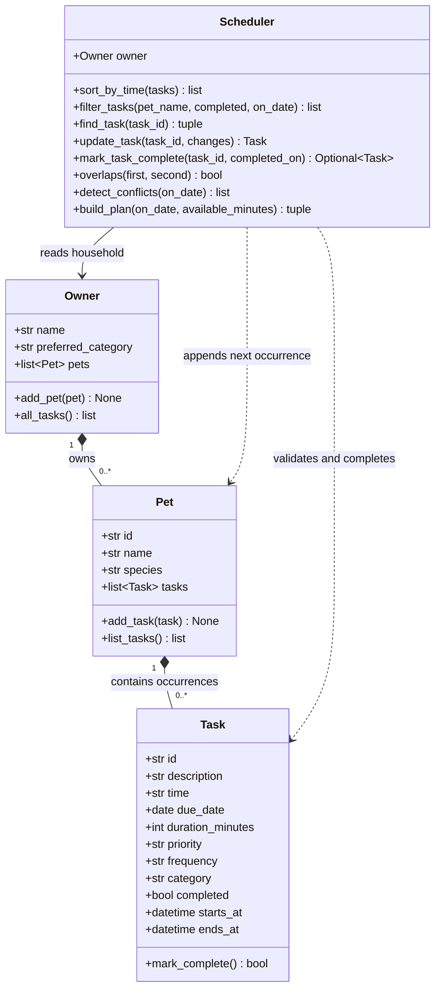

# PawPal+

A Python and Streamlit pet-care scheduler for CodePath AI110 Project 2.
Track care across multiple pets, keep a readable daily schedule, and choose
tasks within a time budget without silently dropping unfinished work.

## Run locally (Windows)

Requires Python 3.10+. Tested with Python 3.10, Streamlit 1.60.0 and pytest 9.1.1.
From the repository folder:

```powershell
py -m venv .venv
.venv\Scripts\Activate.ps1
py -m pip install -r requirements.txt
py main.py
py -m pytest -q
py -m streamlit run app.py
```

Open the localhost URL printed by Streamlit. If PowerShell blocks activation,
run `.venv\Scripts\python.exe -m pip install -r requirements.txt` and use that
virtual-environment executable for the same demo, test, and Streamlit commands.

## Features

- Owner settings, multiple pets, and duplicate-name validation.
- Add and edit dated tasks with duration, priority, activity type and frequency.
- Chronological schedules with pet, date and completion-status filters.
- Daily and weekly recurrence with completion history and duplicate protection.
- Overlap warnings for the same pet or different pets, including midnight.
- Priority-first plans with a minute budget and preferred-activity tie breaking.
- Explicit explanations for selected and skipped tasks.
- Streamlit session memory, empty states, confirmations, tables and summary counts.

## Design and classes

`pawpal_system.py` is independent of the UI. `Task` represents one occurrence;
`Pet` owns a task collection; `Owner` manages pets and a preference;
`Scheduler` reads and manages tasks across the household. Task and Pet are
dataclasses, and list defaults are independent for every object.

The draft is in `diagrams/uml_draft.mmd`; the final source is
`diagrams/uml_final.mmd`. New details in the final design include stable task
IDs, activity preferences, validated editing and overlap intervals.



## Smarter Scheduling

| Feature | Method | Behavior |
| --- | --- | --- |
| Time sorting | `Scheduler.sort_by_time()` | Stable sort by date then HH:MM, without modifying the original list. |
| Filtering | `Scheduler.filter_tasks()` | Combine pet name, completion state and calendar date. `None` means no restriction. |
| Conflicts | `Scheduler.detect_conflicts()` / `overlaps()` | Warn about overlapping pending intervals across all pets. Adjacent endpoints are allowed; completed tasks do not block time. |
| Recurrence | `Scheduler.mark_task_complete()` | Complete the old occurrence and append one new pending daily/weekly occurrence with a new ID. A repeated completion creates nothing. |
| Editing | `Scheduler.update_task()` | Validate a replacement before changing a pending task; preserve its ID. Completed history cannot be edited. |
| Priority plan | `Scheduler.build_plan()` | Rank high before medium before low, then preferred activity, then earliest due time. Include a task only if it fits the minute budget and does not overlap a selected or overnight task. Return chronological results and reasons. |

**Recurrence rule:** the next date is `max(original_due_date, completion_date)`
plus 1 or 7 days. An overdue daily task completed today recurs tomorrow; a future
task completed early stays on its original cadence. Direct `Task.mark_complete()`
changes only that occurrence's flag; use the Scheduler method for recurrence.

**Planning tradeoff:** this is a greedy fixed-time plan, not an optimizer. It may
complete fewer tasks than shortest-first selection, which is intentional: Furkan
selected priority first, then preferred activity. It never moves appointments.
Skipped tasks remain pending. Overnight tasks from a previous date block their
occupied intervals; their full duration belongs to the day they started.

Sorting takes O(n log n); filtering takes O(n). Conflict detection and planning
can take O(n²) in the worst case, which is acceptable for a small household.

## Demo Walkthrough

1. Start the app and click **Load example household** to load two fictional pets,
   Mochi and Luna, with five tasks for the current day. Alternatively, enter an
   owner name and preference, then use **Pets → Add pet**.
2. Open **Add / edit tasks**. Choose a pet, enter a description, date, time,
   duration, priority, repeat frequency and activity type. Click **Schedule task**.
3. Open **Daily schedule**. Tasks appear chronologically. Filter by pet or status.
   The example walk at 18:00 overlaps grooming at 18:15, so a household warning
   appears even when a pet filter hides one of those tasks.
4. To fix a conflict, choose the task in **Edit a pending task**, change its time
   or duration, and save. The schedule and warnings are recalculated.
5. Open **Build a plan**, keep the 75-minute budget, and click **Generate plan**.
   The three high-priority tasks and the walk fit; grooming is skipped because
   it overlaps the walk. Read the individual selection and skip explanations.
6. Complete a daily task from **Daily schedule**. Its original row becomes
   Complete, and a pending occurrence appears on the next day. Change the date
   filter to see it. Completing a once-only appointment creates no new task.

`main.py` uses a fixed example date, 2026-10-23, so its output is reproducible
regardless of the date it is run. The interactive example uses the current day.
The aligned CLI table is produced by `main.format_schedule()` using Python
format strings. The UI uses `st.dataframe`, `st.table`, `st.metric`, `st.success`,
`st.warning` and a custom theme in `.streamlit/config.toml`.

### Sample Output

Actual output of `py main.py`:

```text
Today's Schedule - 2026-10-23 (fixed demo date)
DATE       TIME  PET      TASK                     MIN PRIORITY STATUS
---------- ----- -------- ------------------------ --- -------- --------
2026-10-23 08:00 Mochi    Breakfast                 10 high     pending
2026-10-23 09:00 Luna     Medication reminder        5 high     pending
2026-10-23 11:00 Luna     Vet appointment           30 high     pending
2026-10-23 18:00 Mochi    Evening walk              30 medium   pending
2026-10-23 18:15 Luna     Grooming                  20 low      pending

Pending tasks for Luna
DATE       TIME  PET      TASK                     MIN PRIORITY STATUS
---------- ----- -------- ------------------------ --- -------- --------
2026-10-23 09:00 Luna     Medication reminder        5 high     pending
2026-10-23 11:00 Luna     Vet appointment           30 high     pending
2026-10-23 18:15 Luna     Grooming                  20 low      pending

Conflict warnings
Conflict: Mochi / Evening walk (2026-10-23 18:00) overlaps Luna / Grooming (2026-10-23 18:15).

Priority-first plan: 75 minutes, preferred activity = walk
DATE       TIME  PET      TASK                     MIN PRIORITY STATUS
---------- ----- -------- ------------------------ --- -------- --------
2026-10-23 08:00 Mochi    Breakfast                 10 high     pending
2026-10-23 09:00 Luna     Medication reminder        5 high     pending
2026-10-23 11:00 Luna     Vet appointment           30 high     pending
2026-10-23 18:00 Mochi    Evening walk              30 medium   pending
Selected Mochi / Breakfast: high priority; 10 min fits (10/75 min used).
Selected Luna / Medication reminder: high priority; 5 min fits (15/75 min used).
Selected Luna / Vet appointment: high priority; 30 min fits (45/75 min used).
Selected Mochi / Evening walk: medium priority; preferred activity; 30 min fits (75/75 min used).
Skipped Luna / Grooming: overlaps an already selected task.

Completed Breakfast; next daily occurrence: 2026-10-24 08:00
Repeated completion creates another task: False

Tomorrow's schedule
DATE       TIME  PET      TASK                     MIN PRIORITY STATUS
---------- ----- -------- ------------------------ --- -------- --------
2026-10-24 08:00 Mochi    Breakfast                 10 high     pending
```

## Testing PawPal+

```powershell
py -m pytest -q
```

`tests/test_pawpal.py` checks task completion and addition, independent lists,
chronological sorting across pets/dates, combined filters, daily/weekly/once
recurrence, repeated completion, overdue and early completion, month/year/leap
boundaries, exact and partial overlaps, adjacent tasks, midnight, completed-task
exclusion, budget limits, priority/preference ordering, invalid edits and inputs,
empty households, and recurrence date overflow.

`tests/test_app.py` uses Streamlit AppTest to submit real forms and verify
session-state behavior. It covers add → edit → plan → complete, example loading,
pet filtering, conflict visibility, blank input and owner preferences.

Captured passing output:

```text
.........................................                                [100%]
41 passed in 5.37s
```

Raw evidence is in `evidence/cli-output.txt` and `evidence/pytest-output.txt`.
The live-browser plan is captured in `evidence/browser-plan.png`.
An initial UI test exposed stale selector state after editing. Editing and
completion now use callbacks before rendering, so the selector, schedule and
plan all see the updated domain data.

**AI assessment of confidence: 4/5.** The tested behavior is covered by domain
and UI checks, plus a live-browser check. This is not a student-authored confidence
rating and is not a guarantee of production reliability.

## Limits

- Data is stored in `st.session_state`, not on disk. It survives normal UI
  interactions; reloading or closing the session can clear it. There is no JSON
  save/load feature or multi-user synchronization.
- Dates and times are local and timezone-naive; DST/timezone conversion is not
  modeled. This is a reminder demo, not a notification or medical-advice service.
- A task's full duration counts against its start date's care budget. Time
  windows, travel time and optimal scheduling are outside this project's scope.
- A daily schedule filters by due date, not by every day touched by a task.
  Conflict warnings still account for overnight overlaps.

## AI collaboration and ownership

This implementation, tests and documentation were generated with Codex. Furkan
requested the project, confirmed he was starting fresh, and selected the
priority-first/preferred-activity policy. No independent coding authorship is
claimed. `ai_interactions.md` records the actual workflow and verification.
`reflection.md` distinguishes confirmed student input from technical notes that
still need his personal review. No CodePath submission was made.
